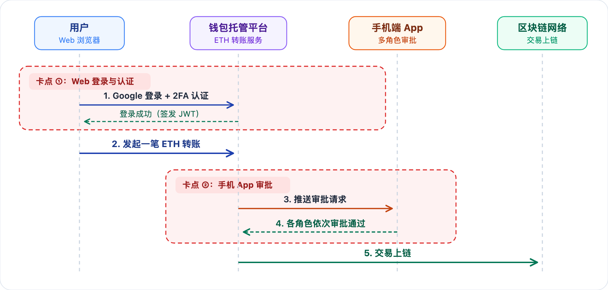
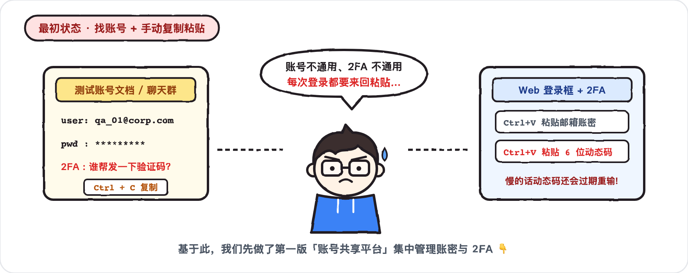
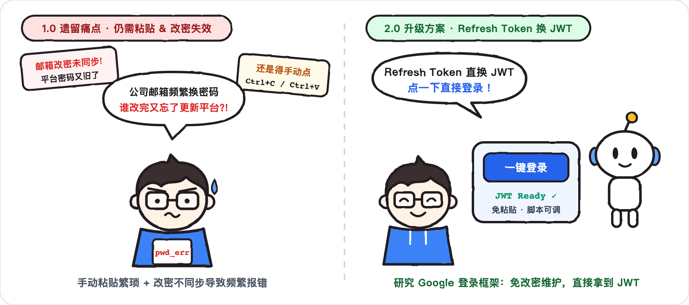
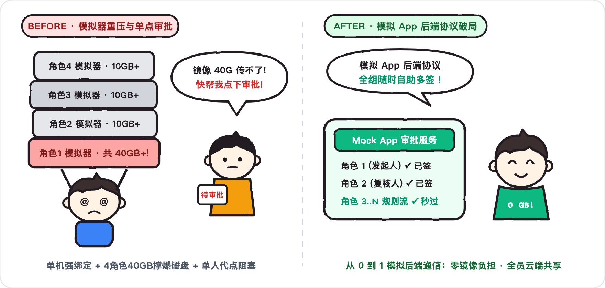
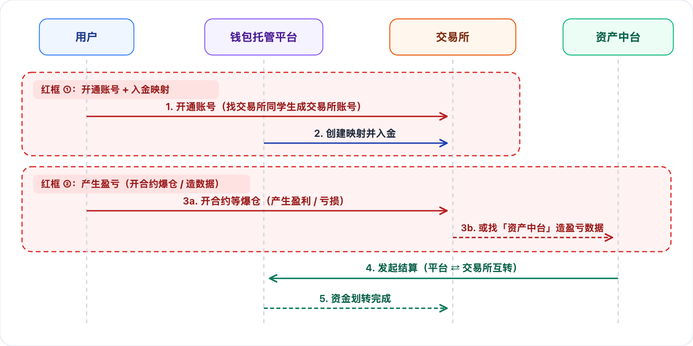
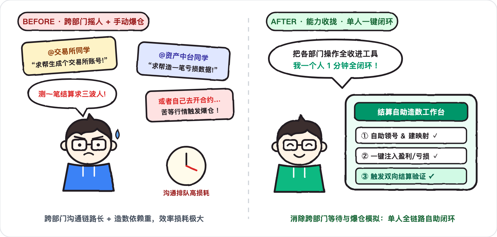
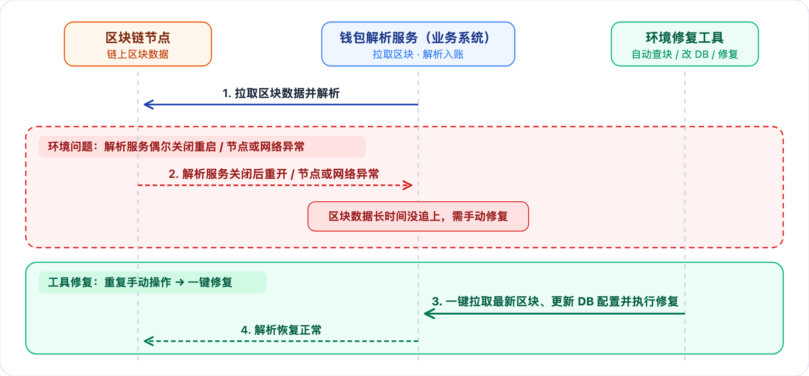
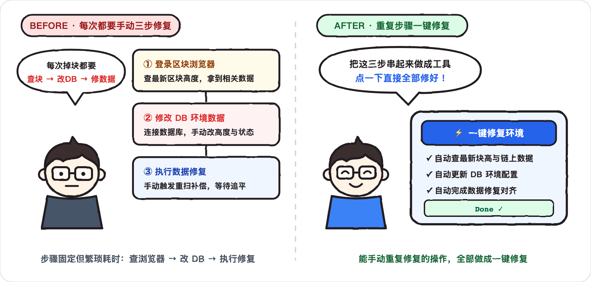
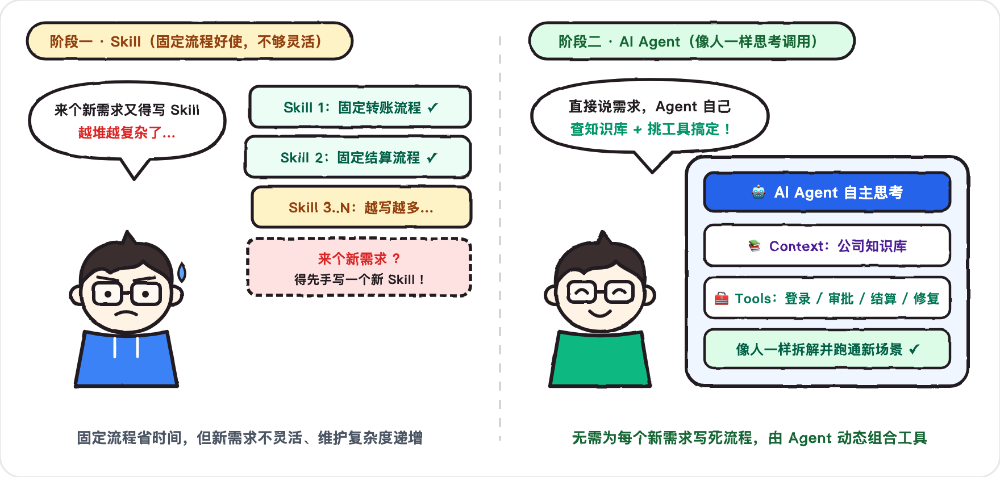
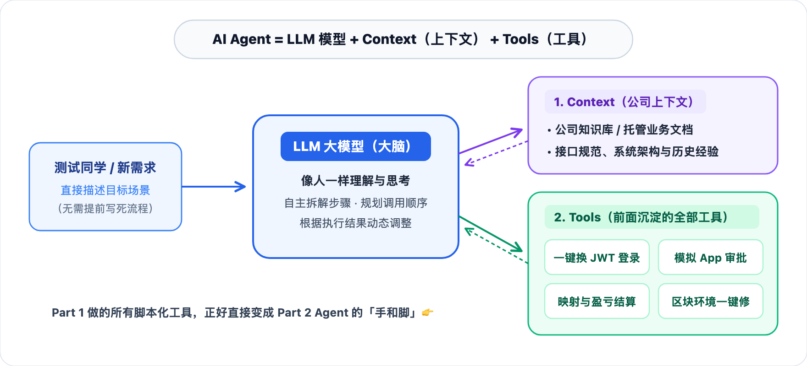

# 钱包工具开发分享 - 托管

## 一、从 0 到 1

以一笔 **ETH 转账交易**为例：用户在 Web 端完成 Google 登录与 2FA 认证 → 发起转账 → 手机端 App 审批 → 交易上链。

### 1.1 卡点一：浏览器登录（Google + 2FA）

最初 Google 账号和 2FA 都不通用，每次登录都要到处找账号、手动复制粘贴账密和动态码：

> 🖼️ **【待插入截图 / 视频】**：1.0 账号共享平台实际操作演示

做了第一版共享平台后，依然存在两个问题：**① 还是得手动复制粘贴**；**② 公司邮箱定期强制改密，一旦漏同步平台就会报错**。于是我们深入研究了 Google 登录认证框架，直接用 **Refresh Token 换取 JWT**，点一下即可完成登录：

> 🖼️ **【待插入截图 / 视频】**：2.0 一键登录工具实际操作演示

### 1.2 卡点二：手机端多角色审批

- **做之前**：实体机一机一号强绑定（删 App 即丢号）；改用 Android 模拟器后，单角色 10GB+、4 个角色就要占 **40GB+**，且镜像太大无法共享，只能由一个人代点审批。
- **做之后**：拆解审批底层协议，从 0 到 1 模拟 App 后端，**0 GB** 本地占用，全组随时自助完成多角色审批。

> 🖼️ **【待插入截图 / 视频】**：模拟 App 审批工具实际操作截图

> 💡 **思路小结**：
> 1. 先把主流程完整串一遍，找出测试里真正高频遇到、最卡效率的地方重点解决。
> 2. 更关键的是，**这也是后续做自动化的基础** —— 无论是网页端 Google 登录还是手机端 App 审批，如果不先打通底层、支持用脚本直接调用，端到端自动化根本无法开展。

---

## 二、从多人到单人

以**钱包托管平台与交易所的映射结算**为例：先开通交易所账号并入金建立映射，再在交易所产生盈利或亏损，最后触发双向结算。

- **做之前**：测一笔结算要跨多个团队 —— 找**交易所同学**生成交易所账号，再去交易所手动开合约等爆仓，或者找**资产中台**帮忙造盈亏数据，沟通等待耗时很长。
- **做之后**：把这些跨团队操作全部收拢做成工具，测试同学**自己一个人就能跑通生成账号、建映射、造盈亏到结算的全流程**。

> 🖼️ **【待插入截图 / 视频】**：映射与结算工具实际操作截图

> 💡 **思路小结**：涉及多人、多部门配合才能走完的流程，尽量把外部依赖操作工具化收拢过来，变成一个人就能独立闭环。

---

## 三、复杂、常见的环境问题

以**区块链节点与钱包解析服务（业务系统）**为例：解析服务持续从节点拉取区块数据；当解析服务偶尔关闭重开，或遇到节点、网络异常时，区块高度就会落后，需要等待很久或手动处理。

- **做之前**：每次遇到掉块都要手动分步处理 —— ① 先登录区块浏览器查最新区块高度并拿相关数据 → ② 去修改 DB 里的环境数据 → ③ 再执行数据修复，步骤固定但每次都要花不少时间。
- **做之后**：把这套重复的手动修复步骤直接串起来封装成工具，点一下即可**一键完成修复**。

> 🖼️ **【待插入截图】**：环境一键修复工具实际操作截图

> 💡 **思路小结**：针对系统里复杂且经常出现的环境问题，只要是能手动重复修复的操作，就做成一键全部修复。

---

## 四、小结

| 阶段 | 做之前 | 做之后 |
| :--- | :--- | :--- |
| **1. 从 0 到 1** Web 登录 & 手机审批 | 手动粘贴、改密不同步；4 角色模拟器占 **40GB+** 且只能单人审批，无法做自动化 | **Refresh Token** 直换 **JWT** + 模拟 App 后端审批，全组共享，打通**自动化基础** |
| **2. 从多人到单人** 映射与盈亏结算 | 找交易所同学生成账号、手动开合约等爆仓或找资产中台造数据 | 外部操作收拢进工具，**单人独立闭环** |
| **3. 复杂常见环境问题** 区块同步与数据修复 | 查区块浏览器拿数据 → 改 DB 环境数据 → 手动执行修复 | 重复手动步骤串联封装，**一键修复** |

---

## Part 2：AI 探索 —— 从 Skill 到 AI Agent

把基础工具都打通以后，我们在 AI 上的应用也经历了两个阶段：

### 1. 第一阶段：用 Skill 跑固定流程

- **好用的地方**：针对已经确定好的固定流程，Skill 非常好使，帮我们节省了大量重复操作的时间。

> 📊 **【待补充数据 / 截图】**：Skill 阶段的实际提效数据与运行效果

- **遇到的问题**：用下来发现 Skill 还是**不够灵活** —— 它只能覆盖既有流程；一旦来了新需求，就得先专门新写一个 Skill。随着场景越来越多，Skill 越堆越多，整体维护复杂度也跟着往上升。所以对我们来说，Skill 是一个“能用、省了不少时间，但还没有特别好用”的第一阶段探索。

### 2. 第二阶段：走向 AI Agent

那什么是 AI Agent？按比较通用的定义，**AI Agent = LLM 模型 + Context（上下文）+ Tools（工具）**。

落到我们自己的业务里，刚好可以把前面积累的东西全部串起来：
- **Context（上下文）**：直接结合**公司的知识库**（业务文档、接口说明、系统逻辑）；
- **Tools（工具集）**：把我们**在第一部分里做好的所有测试工具**（一键换 JWT 登录、模拟 App 审批、映射与盈亏结算、区块环境修复等）全部集中放到 Tools 里面。

这样一来，AI Agent 就能结合公司知识库理解业务，再自己挑选、组合这些工具，真正**像人一样去思考和完成测试任务**。

> 🚀 **【待补充案例 / 演示】**：AI Agent 结合公司知识库与测试工具的实际运行例子

> 💡 **前后串联小结**：第一部分把散落在网页、手机端、跨部门和底层环境里的手工操作做成可脚本调用的工具，不只是提效和做自动化的基础，也正好成了第二部分 AI Agent 手里可直接调用的 **Tools**。
